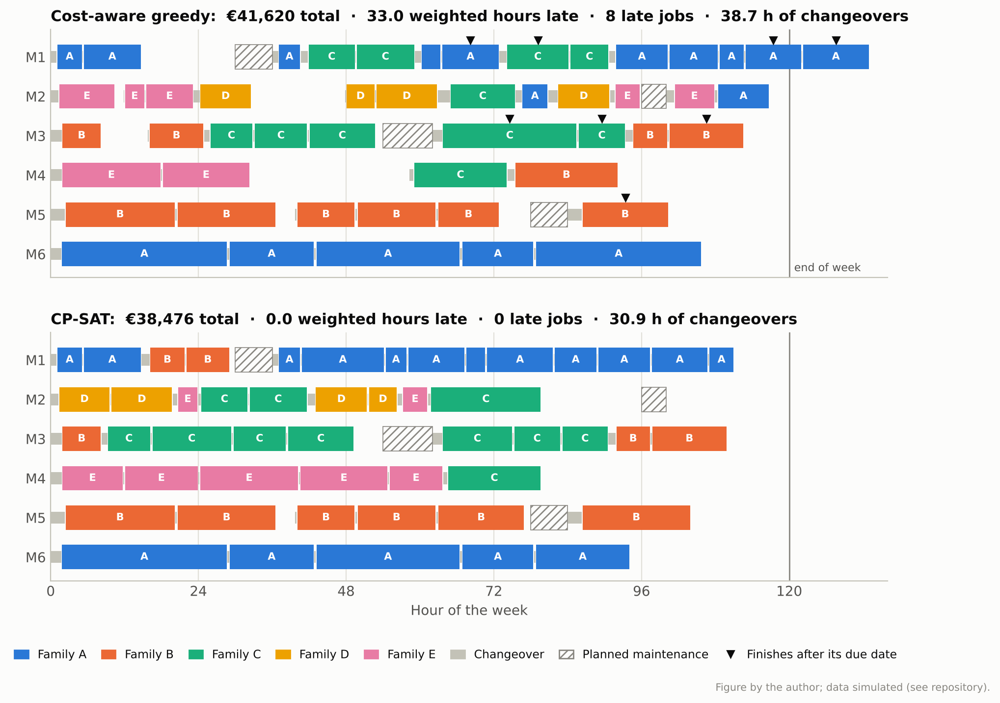

# machine-allocation

[](https://github.com/DiogoRibeiro7/machine-allocation/actions/workflows/ci.yml)
[](pyproject.toml)
[](LICENSE)

Companion code for the article
[*Machine Allocation on a Production Line*](https://medium.com/@diogo-ribeiro-1975/machine-allocation-on-a-production-line-requirements-a-constraint-model-and-the-data-science-182f2ac7d579).

A simulated plant with six unrelated parallel machines, machine eligibility, material
release dates, sequence-dependent changeovers and planned maintenance; a CP-SAT model that
minimises lateness penalties plus operating cost; three constructive rules to compare it
with; and five experiments around it.



## The problem

| | |
| --- | --- |
| Machines | Six, in three age classes. Newer machines run faster and change over faster but cost more per hour (€95, €70 and €48). |
| Jobs | Five product families. Not every machine can run every family. |
| Changeovers | Asymmetric and sequence-dependent, family to family. The first job, and the first job after a stop, needs a cold start. |
| Time constraints | Release dates when material arrives late, due dates, and priority weights of 1, 2 or 5. |
| Stops | Planned maintenance on four machines. For rescheduling, unplanned breakdowns. |
| Objective | A penalty per weighted hour late (€60 by default), plus running cost, plus €1 per changeover minute. |
| Run times | Real times depart from nameplate rates by machine class, material grade and lot size, plus noise. Planners only see a historical log. |

All data are simulated. The plant parameters are in
[`src/machine_allocation/instance.py`](src/machine_allocation/instance.py).

## Installation

Python 3.11 or later.

```bash
git clone https://github.com/DiogoRibeiro7/machine-allocation.git
cd machine-allocation
python -m venv .venv
source .venv/bin/activate            # Windows: .venv\Scripts\activate
pip install -e ".[figures]"          # ".[dev]" adds the test and lint tools
```

## Quick start

```python
from machine_allocation.heuristics import best_baseline
from machine_allocation.instance import int_times, make_instance
from machine_allocation.model import solve
from machine_allocation.simulate import evaluate

inst = make_instance(n_jobs=20, horizon_h=48)       # simulated plant and order book
P = int_times(inst, inst.true_mean)                  # whole minutes per job and machine; -1 if ineligible
pen = 1.0                                            # EUR per weighted minute late
hint, rule = best_baseline(inst, P, pen)             # best of EDD, tuned ATCS and the greedy rule
res = solve(inst, P, time_limit=10, penalty_per_min=pen, hint_seqs=hint)

for name, plan in ((rule, hint), ("CP-SAT", res["seqs"])):
    ev = evaluate(inst, plan, P, pen)
    print(f"{name:7} €{ev['total']:,.0f}   {ev['weighted_tardiness_h']:.1f} weighted hours late")
```

```text
EDD     €15,260   15.1 weighted hours late
CP-SAT  €13,100   0.5 weighted hours late
```

A plan is a dict `machine -> sequence`. A sequence lists job indices in the order they run,
and a planned stop is written as `-(k+1)` for stop `k` of that machine. `time_limit` is in
CP-SAT's deterministic work units, not seconds (see [Reproducing](#reproducing-the-article)).

## Package

| Module | Contents |
| --- | --- |
| [`instance`](src/machine_allocation/instance.py) | Plant and order-book generator |
| [`model`](src/machine_allocation/model.py) | CP-SAT model: optional intervals plus a circuit constraint per machine. Also covers rescheduling with frozen work and a cap on machine changes. |
| [`heuristics`](src/machine_allocation/heuristics.py) | EDD list rule, tuned ATCS dispatching, cost-aware greedy |
| [`simulate`](src/machine_allocation/simulate.py) | Order-preserving execution and scoring |
| [`times`](src/machine_allocation/times.py) | Production log and the four processing-time estimators |

## Reproducing the article

```bash
pip install -e ".[figures]"
./run_all.sh                     # every experiment, into results/
python experiments/figures.py    # every figure, into figures/
```

| Script | Question | Results | Figures |
| --- | --- | --- | --- |
| `exp1_reference_plan.py` | The reference week: three rules and the solver | `exp1_reference_plan.json`, `exp1_plans.pkl` | `fig1_gantt`, `fig2_anytime` |
| `exp2_frontier.py` | Operating cost against lateness, by penalty (`VOLUME=1.1` for the larger order book) | `exp2_frontier.json`, `exp2_frontier_v110.json` | `fig3_frontier` |
| `exp3_run_times.py` | Plans built on five processing-time matrices, three solver seeds each, executed | `exp3_run_times.json` | `fig4_run_times`, `fig5_slack` |
| `exp4_breakdown.py` | A machine fails mid-week: right-shift or re-optimise | `exp4_breakdown.json` | |
| `exp5_scaling.py` | 20 to 120 jobs at a fixed solver budget | `exp5_scaling.json` | |
| `exp5b_large_long.py` | The 120-job instance with six times the budget | `exp5b_large_long.json` | |
| `exp6_load.py` | The same order book at different volumes | `exp6_load.json` | `fig6_load` |

Experiment 1 must run first; the others only need its output. `run_all.sh` options:

- `QUICK=1 ./run_all.sh` is a smoke test with tiny budgets. It writes to `results_quick/`, and
  `QUICK=1 python experiments/figures.py` then draws into `figures_quick/`. CI runs both.
- `FROM=exp3 ./run_all.sh` skips the experiments listed before the first match.
- `PYTHON=python3.12 ./run_all.sh` picks the interpreter.

Each experiment logs to `results/<name>.log`, and the script exits non-zero if any experiment
failed. On Windows, run it from Git Bash.

The solver runs with four interleaved workers and a deterministic-time budget, so a run
returns the same plans on any machine with the same OR-Tools version (9.15 here). Wall-clock
time is machine-dependent: the full set is 49 solves and took just under three hours on two
cores. `exp3_run_times.py` caches each finished solve in `results/exp3_cache/` and can be
interrupted and resumed; delete that folder to recompute.

Every solve runs in its own process (`solve_isolated` in
[`model.py`](src/machine_allocation/model.py)) and is retried if the process dies. That is not
decoration: the native solver aborted twice with a memory fault while these results were being
produced, and both times the retry returned the plan.

## Development

```bash
pip install -e ".[dev]"
pre-commit install       # ruff and file hygiene on every commit
pytest                   # unit and integration tests
ruff check .
mypy
```

The tests pin down the properties the experiments rely on:

- Every rule and every solve produces a valid plan that stays clear of maintenance.
- At a proven optimum, the CP model and the simulator price a plan identically.
- Rescheduling respects frozen work and the cap on machine changes.
- The isolated solver process returns the same plan as an in-process solve.
- The learned run-time estimators rank as experiment 3 reports.

## Citation

If you use this code, please cite the article
[*Machine Allocation on a Production Line*](https://medium.com/@diogo-ribeiro-1975/machine-allocation-on-a-production-line-requirements-a-constraint-model-and-the-data-science-182f2ac7d579).
[`CITATION.cff`](CITATION.cff) has the details in a machine-readable form, and GitHub offers it
as BibTeX or APA under "Cite this repository".

## License

[Apache License 2.0](LICENSE).
